# 🚀 Awesome Multi-Model Database [](https://github.com/ishandutta2007/Awesome-Awesome-Awesome)

<p align="center">
  
</p>

<p align="center">
  <a href="https://github.com/ishandutta2007/Awesome-Awesome-Awesome"></a><a href="https://discord.gg/jc4xtF58Ve"></a>
  <a href="https://github.com/ishandutta2007/Awesome-Multi-Model-Database/stargazers"></a>
  <a href="https://github.com/ishandutta2007/Awesome-Multi-Model-Database/network/members"></a>
  <a href="https://github.com/ishandutta2007/Awesome-Multi-Model-Database/blob/main/LICENSE"></a>
  <a href="https://github.com/ishandutta2007/Awesome-Multi-Model-Database/pulls"></a>
  <a href="https://github.com/ishandutta2007"></a>
</p>

---

## 📖 Overview & SEO Quick Reference

A **Multi-Model Database (MMDB)** is a database management system engineered to natively ingest, store, index, and query data across multiple mathematical data models—including **Document (JSON/BSON)**, **Graph (Property Graph/RDF)**, **Key-Value**, **Vector (k-NN/ANN Embeddings)**, **Relational (SQL/Tables)**, and **Time-Series**—within a unified storage architecture and execution engine. 

Instead of deploying fragmented polyglot persistence stacks that require fragile ETL pipelines and distributed synchronization glue, modern multi-model engines deliver **single-engine ACID transactions**, **unified declarative query languages** (such as SurrealQL, AQL, SQL++, Cypher, and Optic API), and **sub-millisecond cross-model data traversal**.

> **Keywords**: Multi-Model Database, MMDB, Document Store, Graph Database, Vector Database, Key-Value Store, NoSQL, Polyglot Persistence, Distributed Database, ACID Transactions, Hybrid Query Engine, Graph Traversals, SurrealDB, ArangoDB, Cosmos DB, DynamoDB.

---

## 📑 Table of Contents

- [📊 Sector Overview & Market Dynamics](#-sector-overview--market-dynamics)
- [☁️ SaaS & Hosted Platforms](#️-saas--hosted-platforms)
- [🛠️ Open-Source GitHub Projects](#️-open-source-github-projects)
- [🧩 Architectural Comparison: Native vs. Layered Multi-Model](#-architectural-comparison-native-vs-layered-multi-model)
- [🤝 How to Contribute](#-how-to-contribute)
- [💖 Support & Community](#-support--community)
- [⭐ Star History](#-star-history)
- [📜 Disclaimer & License](#-disclaimer--license)

---

## 📊 Sector Overview & Market Dynamics

The global **Multi-Model Database (MMDB)** market was valued at **$7.3 Billion in 2024** and is projected to expand to **$28.5 Billion by 2031**, progressing at a compound annual growth rate (**CAGR) of 21.4%**. 

The sector exhibits **moderate fragmentation with high functional specialization**: while Tier-1 hyperscalers (Microsoft Azure Cosmos DB and Amazon DynamoDB) capture substantial enterprise spend through cloud-native consolidation and global SLAs, specialized multi-model pioneers (SurrealDB, ArangoDB, Couchbase, and Gel) command significant technological defensibility through native cross-model ACID execution, unified graph-document-vector query abstractions, and edge-to-cloud flexibility, preventing a single winner-take-all monopoly and fueling continuous innovation across both managed SaaS and open-source ecosystems.

---

## ☁️ SaaS & Hosted Platforms

The following SaaS multi-model database providers are ranked in **descending order by company scale (market capitalization or total valuation)**. Starting prices and free tier quotas represent verifiable, non-generic tier specifications.

| Platform | Company & Scale (Valuation / Revenue) | Starting Pricing | Free Tier Limits | Supported Models & Key Strengths |
| :--- | :--- | :--- | :--- | :--- |
| **[Azure Cosmos DB](https://azure.microsoft.com/en-us/products/cosmos-db)** | **Microsoft**<br>📊 ~$3.10T Market Cap<br>📈 ~$245B Annual Revenue | **Serverless**: $0.25 per 1M Request Units (RUs) + $0.25/GB/mo storage.<br>**Provisioned**: Starts at $0.008/hour (~$5.84/mo for 400 RU/s). | **Free Tier Forever**: 1,000 RU/s throughput + 25 GB storage free every month per Azure subscription (plus 30-day $200 credit trial). | **Document (NoSQL/Mongo), Graph (Gremlin), Key-Value (Table), Cassandra, Vector & PostgreSQL**.<br>Turnkey global replication, 99.999% availability SLA, sub-10ms reads and writes. |
| **[Amazon DynamoDB](https://aws.amazon.com/dynamodb/)** | **Amazon (AWS)**<br>📊 ~$2.05T Market Cap<br>📈 ~$105B AWS Annual Run Rate | **On-Demand**: $1.25 per 1M write units (WRUs) & $0.25 per 1M read units (RRUs) + $0.25/GB/mo.<br>**Provisioned**: ~$0.00065/WCU-hr & ~$0.00013/RCU-hr. | **Free Tier Forever**: 25 GB storage, 25 provisioned Write Capacity Units (WCU), and 25 provisioned Read Capacity Units (RCU) — handling ~200M requests/mo. | **Key-Value & Document (JSON)**.<br>Serverless microsecond latencies, built-in in-memory caching via DAX, seamless AWS IAM and EventBridge integration. |
| **[MongoDB Atlas](https://www.mongodb.com/products/platform/atlas-database)** | **MongoDB Inc.**<br>📊 ~$21.5B Market Cap<br>📈 ~$1.75B Annual Revenue | **Shared M2**: Starts at $0.012/hour (~$9.00/month).<br>**Dedicated M10**: Starts at $0.08/hour (~$57.00/month). | **Free Tier Forever (M0)**: 512 MB shared storage, shared RAM/vCPU, 100 max connections, and basic Atlas Search indexing. | **Document (BSON/JSON), Vector Search, Time-Series, Key-Value & Graph ($graphLookup)**.<br>Largest developer ecosystem, native vector search, triggers, and flexible aggregation pipelines. |
| **[MarkLogic Cloud](https://www.marklogic.com/product/marklogic-database/)** | **Progress Software**<br>📊 ~$2.60B Market Cap<br>📈 ~$700M Annual Revenue | **Managed Cloud**: Starts at $0.58/hour (~$423.40/month) on AWS and Azure Marketplace for basic cluster units. | **14-Day Free Cloud Trial**: Full enterprise access on AWS/Azure Marketplace, or 30-day downloadable developer evaluation license. | **Document (JSON/XML), RDF Graph (SPARQL), Relational Views (SQL) & Full-Text Search**.<br>Universal Indexing, bitemporal auditing, petabyte scalability, government-grade security. |
| **[Couchbase Capella](https://www.couchbase.com/products/capella/)** | **Couchbase Inc.**<br>📊 ~$1.15B Market Cap<br>📈 ~$190M Annual Revenue | **Developer Pro**: Starts at $0.268/node/hour (~$195.64/month per node) on AWS, GCP, or Azure. | **30-Day Free Trial**: 1 free cluster (up to 3 nodes, 50 GB NVMe storage, 8 GB RAM) with no credit card required. | **JSON Document, Key-Value, SQL++ (N1QL) Queries, Vector Search & Full-Text Search**.<br>Memory-first architecture, workload isolation across querying, indexing, and analytics services. |
| **[Fauna](https://fauna.com/)** | **Fauna Inc.**<br>📊 ~$450M Valuation<br>📈 ~$136M Venture Backed | **Starter Plan**: $25.00/month (includes 50M compute ops + 5GB storage; then $0.15/GB/mo storage and $0.40/M reads). | **Free Tier Forever**: 100,000 read ops/day, 50,000 write ops/day, 2.5 GB storage, and up to 5 individual databases. | **Document, Relational & Graph-like Joins via FQL**.<br>Serverless global distribution, zero provisioning, ACID consistency without operational overhead. |
| **[ArangoGraph Insights](https://cloud.arangodb.com/)** | **ArangoDB Inc.**<br>📊 ~$180M Valuation<br>📈 ~$47M Venture Backed | **Developer Tier**: Starts at $0.06/hour (~$43.20/month) for a single-server 2 vCPU / 4 GB instance. | **14-Day Free Trial**: $200 free cloud credits across AWS, GCP, and Azure with cluster deployment and no credit card required. | **Native Graph, Document, Key-Value, Vector Similarity & Full-Text Search (AQL)**.<br>Single declarative query language across all models, SmartGraphs sharding, enterprise GraphML. |
| **[SurrealDB Cloud](https://surrealdb.com/cloud)** | **SurrealDB Ltd.**<br>📊 ~$120M Valuation<br>📈 ~$26M Venture Backed | **Production Tier**: Starts at $0.027/hour (~$19.71/month) for 1 vCPU and 2 GB RAM with dedicated NVMe storage. | **Free Tier Forever (Sandbox)**: 1 vCPU, 1 GB RAM, 5 GB storage, and up to 3 databases free forever for prototyping. | **Document, Graph, Vector, Relational, Time-Series & Geospatial via SurrealQL**.<br>Real-time live queries (`LIVE SELECT`), embedded permissions, WASM extensibility, ACID transactions. |

---

## 🛠️ Open-Source GitHub Projects

The leading open-source multi-model database repositories are ranked below in **descending order by GitHub Stars_Count**. Click any Stars_Badge to inspect real-time stargazers.

### 1. [SurrealDB](https://github.com/surrealdb/surrealdb) [](https://github.com/surrealdb/surrealdb/stargazers)
- **Supported Models**: 📄 Document, 🕸️ Graph, 🧠 Vector, 🗄️ Relational, ⏱️ Time-Series, 🌍 Geospatial
- **Primary Language & Core**: Rust
- **Query Interface**: `SurrealQL` (SQL-style syntax with graph operators like `->` and `<-`, KNN vector search, and real-time live queries)
- **Architecture Highlights**: Unifies six distinct data models natively inside a single ACID storage engine. Features embedded row-level security and JWT auth within the database engine, avoiding sidecars. Can be deployed as an embedded database in Rust/Python/WASM or as a multi-node distributed cluster.
- **Best For**: Full-stack web/mobile applications, real-time collaboration engines, and teams replacing complex stacks with a single lightweight binary.

### 2. [Dgraph](https://github.com/dgraph-io/dgraph) [](https://github.com/dgraph-io/dgraph/stargazers)
- **Supported Models**: 🕸️ Distributed Property Graph, 📄 Document (JSON), 🧠 Vector Embeddings, 🔑 Key-Value
- **Primary Language & Core**: Go
- **Query Interface**: Native `GraphQL` and `GraphQL+-` (an expressive graph query dialect based on GraphQL)
- **Architecture Highlights**: Built from the ground up for horizontal scaling and low latency on massive graph datasets. Shards and distributes graph data across cluster nodes with Raft consensus and BadgerDB key-value underlying storage.
- **Best For**: Knowledge graphs, fraud detection, social networks, and master data management requiring native GraphQL endpoints.

### 3. [ArangoDB](https://github.com/arangodb/arangodb) [](https://github.com/arangodb/arangodb/stargazers)
- **Supported Models**: 🕸️ Native Graph, 📄 JSON Document, 🔑 Key-Value, 🧠 Vector Search, 🔎 Full-Text Search
- **Primary Language & Core**: C++
- **Query Interface**: `AQL` (ArangoDB Query Language — unified declarative query language for graph traversals, joins, full-text ranking, and vector similarity)
- **Architecture Highlights**: RocksDB-based multi-model core. SmartGraphs feature co-locates interconnected graph nodes to eliminate network hops during traversals. Provides single-instance ACID transactions and OneShard cluster consistency.
- **Best For**: Complex graph traversal workloads combined with unstructured document storage and AI retrieval pipelines.

### 4. [Gel](https://github.com/geldata/gel) *(formerly EdgeDB)* [](https://github.com/geldata/gel/stargazers)
- **Supported Models**: 🗄️ Relational, 🕸️ Graph-Object, 📄 Document (JSON), 🧠 Vector Search
- **Primary Language & Core**: Rust & Python (built on PostgreSQL)
- **Query Interface**: `EdgeQL` (high-level, composable, object-oriented query language eliminating SQL join friction)
- **Architecture Highlights**: Supercharges PostgreSQL by integrating an expressive object-relational graph schema, built-in authentication, migration tooling, and native AI vector indexing without sacrificing Postgres ACID guarantees.
- **Best For**: Modern TypeScript, Python, and Go developers wanting graph and object modeling convenience backed by rock-solid PostgreSQL reliability.

### 5. [NebulaGraph](https://github.com/vesoft-inc/nebula) [](https://github.com/vesoft-inc/nebula/stargazers)
- **Supported Models**: 🕸️ Large-Scale Property Graph, 🔑 Key-Value, 🧠 Vector Search, 📄 Semi-Structured Data
- **Primary Language & Core**: C++
- **Query Interface**: `nGQL` (Nebula Graph Query Language) & `openCypher`
- **Architecture Highlights**: Disaggregated shared-nothing architecture separating stateless compute nodes (`nebula-graphd`) from stateful Raft-based storage nodes (`nebula-storaged`). Designed for super-large datasets containing tens of billions of vertices and trillions of edges.
- **Best For**: Enterprise-scale financial risk control, knowledge graph reasoning, real-time recommendation engines, and telecommunications network analytics.

### 6. [Vespa](https://github.com/vespa-engine/vespa) [](https://github.com/vespa-engine/vespa/stargazers)
- **Supported Models**: 📄 Structured Document, 🧠 Multi-Vector & Tensor, 🔎 Full-Text Search, ⚡ Real-Time Inverted Index
- **Primary Language & Core**: C++ & Java
- **Query Interface**: Vespa Query API & YQL (Yahoo Query Language)
- **Architecture Highlights**: Purpose-built big data AI search and ranking engine. Computes machine learning models, neural tensor transformations, and vector nearest-neighbor search concurrently with structured document filtering in milliseconds.
- **Best For**: Billion-scale semantic search, real-time AI personalization, recommendation engines, and RAG pipelines.

### 7. [Apache Ignite](https://github.com/apache/ignite) [](https://github.com/apache/ignite/stargazers)
- **Supported Models**: 🔑 In-Memory Key-Value, 🗄️ ANSI-99 SQL Relational, 📄 JSON Document, 🧠 Machine Learning / Graph Cache
- **Primary Language & Core**: Java & C++
- **Query Interface**: ANSI-99 `SQL`, Key-Value API, MapReduce, and Continuous Queries
- **Architecture Highlights**: High-performance distributed in-memory data grid and multi-model database. Offers distributed ACID transactions across partitions, in-memory caching tiers, native persistence on disk, and distributed computing grid APIs.
- **Best For**: High-frequency trading, banking transactions, caching acceleration layers, and low-latency hybrid transactional/analytical processing (HTAP).

### 8. [OrientDB](https://github.com/orientechnologies/orientdb) [](https://github.com/orientechnologies/orientdb/stargazers)
- **Supported Models**: 🕸️ Property Graph, 📄 Document, 🔑 Key-Value, 🧱 Object-Oriented, 🌍 Geospatial
- **Primary Language & Core**: Java
- **Query Interface**: Extended SQL with graph navigation syntax and `Apache TinkerPop Gremlin`
- **Architecture Highlights**: The pioneer of multi-model databases. Replaces expensive relational joins with direct pointer links (`LINK` fields) connecting documents as vertices and edges, enabling native multi-model capabilities without foreign keys.
- **Best For**: Enterprise legacy systems, content management platforms, and organizations seeking an established Java-based graph-document database.

### 9. [TypeDB](https://github.com/typedb/typedb) [](https://github.com/typedb/typedb/stargazers)
- **Supported Models**: 🧠 Entity-Relation-Attribute (ERA) Graph, 📄 Polymorphic Document, 🗄️ Relational Conceptual Schema
- **Primary Language & Core**: Rust
- **Query Interface**: `TypeQL` (strongly-typed, declarative conceptual query and reasoning language)
- **Architecture Highlights**: Introduces a type-theoretic data model and native automated deductive reasoning. Treats types, entities, relations, and nested attributes polymorphically with schema-enforced validation and rule-based query resolution.
- **Best For**: Biomedical knowledge bases, cyber defense threat modeling, drug discovery, and complex domain ontologies.

### 10. [CrateDB](https://github.com/crate/crate) [](https://github.com/crate/crate/stargazers)
- **Supported Models**: 🗄️ Relational SQL, 📄 Dynamic JSON Documents, ⏱️ Time-Series, 🧠 Vector Embeddings, 🔎 Full-Text (Lucene)
- **Primary Language & Core**: Java (Postgres wire protocol compatible)
- **Query Interface**: Standard `SQL` (ANSI SQL with extensions for dynamic objects and full-text search)
- **Architecture Highlights**: Combines PostgreSQL wire-level compatibility with Elasticsearch-grade inverted indexing (Apache Lucene) and distributed shared-nothing sharding. Dynamic schemas automatically index new JSON document fields upon ingestion.
- **Best For**: Industrial IoT sensor streams, cybersecurity event logs, operational analytics dashboards, and real-time telemetry.

### 11. [Kùzu](https://github.com/kuzudb/kuzu) [](https://github.com/kuzudb/kuzu/stargazers)
- **Supported Models**: 🕸️ Property Graph, 🗄️ Relational Tables, 📄 Semi-Structured Document, 🧠 Vector Search
- **Primary Language & Core**: C++
- **Query Interface**: `Cypher` (openCypher declarative graph syntax)
- **Architecture Highlights**: Embedded, in-process graph-relational DBMS designed as "the DuckDB of graph databases." Features columnar storage with Factorized Query Execution for blazingly fast graph traversals, joins, and vector similarity without external server processes.
- **Best For**: Embedded graph analytics, Python/R data science workflows, local LLM Graph-RAG pipelines, and desktop applications.

### 12. [AgensGraph](https://github.com/skaiworldwide-oss/agensgraph) [](https://github.com/skaiworldwide-oss/agensgraph/stargazers)
- **Supported Models**: 🕸️ Property Graph & 🗄️ Relational RDBMS (PostgreSQL)
- **Primary Language & Core**: C
- **Query Interface**: Hybrid `SQL` + `Cypher` in the same query statement
- **Architecture Highlights**: Direct integration into the PostgreSQL kernel. Stores relational tables and graph vertices/edges in the same database catalog, enabling developers to write Cypher graph matches and SQL relational joins simultaneously.
- **Best For**: PostgreSQL shops needing deeply integrated graph modeling alongside transactional relational systems.

### 13. [ArcadeDB](https://github.com/ArcadeData/arcadedb) [](https://github.com/ArcadeData/arcadedb/stargazers)
- **Supported Models**: 🕸️ Graph, 📄 Document, 🔑 Key-Value, ⏱️ Time-Series, 🧠 Vector Search, 🔎 Full-Text
- **Primary Language & Core**: Java
- **Query Interface**: `SQL`, `Cypher`, `Gremlin`, `GraphQL`, `MongoDB API`, and `Redis API`
- **Architecture Highlights**: High-performance multi-model engine engineered by the original creator of OrientDB. Multi-API layer allows accessing the same physical data records through Cypher, SQL, MongoDB wire protocol, or Redis key-value operations with ACID transactions.
- **Best For**: Polyglot database migrations, modernizing legacy OrientDB applications, and microservices requiring multi-protocol access.

### 14. [OpenLink Virtuoso](https://github.com/openlink/virtuoso-opensource) [](https://github.com/openlink/virtuoso-opensource/stargazers)
- **Supported Models**: 🗄️ Relational RDBMS, 🕸️ RDF Linked Data Graph, 📄 XML/JSON Document, 🔎 Full-Text
- **Primary Language & Core**: C
- **Query Interface**: `SPARQL`, `SQL`, and hybrid SQL-SPARQL
- **Architecture Highlights**: Enterprise-grade multi-model RDBMS and RDF triple/quad store. Powers massive public semantic web graphs (including DBpedia) with high-performance linked data querying and relational data virtualization.
- **Best For**: Semantic web projects, enterprise knowledge graphs, life sciences ontologies, and Linked Open Data (LOD) portals.

---

## 🧩 Architectural Comparison: Native vs. Layered Multi-Model

When selecting an engine for multi-model workloads, data architects must distinguish between **Native Multi-Model Engines** and **Multi-Model Layered Wrappers**:

```
 ┌────────────────────────────────────────────────────────┐
 │            NATIVE MULTI-MODEL ARCHITECTURE             │
 │  (SurrealDB, ArangoDB, ArcadeDB, OrientDB)             │
 ├────────────────────────────────────────────────────────┤
 │   Unified Query Engine (SurrealQL, AQL, Cypher/SQL)    │
 ├────────────────────────────────────────────────────────┤
 │   Unified Cross-Model ACID Transaction Coordinator     │
 ├────────────────────────────────────────────────────────┤
 │   Single Native Storage Core (Graph + Doc + Vector)    │
 └────────────────────────────────────────────────────────┘

                           VS

 ┌────────────────────────────────────────────────────────┐
 │            LAYERED MULTI-MODEL ARCHITECTURE            │
 │  (Cosmos DB APIs, DynamoDB + DAX, Mongo + Aggregations)│
 ├───────────┬────────────┬───────────┬───────────────────┤
 │ Graph API │  Doc API   │ Table API │    Vector API     │
 ├───────────┴────────────┴───────────┴───────────────────┤
 │         Underlying Storage Layer (Doc / KV / Log)      │
 └────────────────────────────────────────────────────────┘
```

1. **Native Engines** store vertices, edges, document schemas, and vector indexes within a unified storage layer, granting single-query ACID execution across all models without internal network round-trips.
2. **Layered Systems** translate disparate query protocols (e.g., Gremlin or Cassandra) into an underlying document or key-value format, which simplifies API adoption but may introduce latency overhead on deep recursive graph traversals.

---

## 🤝 How to Contribute

Contributions are warmly welcomed! Help keep this multi-model database ecosystem directory accurate and up to date:

1. **Fork** this repository.
2. **Add or refine** entries in `README.md` maintaining the existing structure:
   - Provide product name, official link, verified pricing, and free-tier limits.
   - For open-source repos, include the repository URL, language, query interface, and architecture summary.
3. Verify that all markdown links and SVG badges are functioning.
4. **Submit a Pull Request** with a concise description of your additions.

---

## 💖 Support & Community

Thank you for exploring this curated repository on multi-model databases! If this guide helped you architect your data stack, evaluate engines, or eliminate polyglot database complexity, please consider supporting the project:

- ⭐ **Star this repository** to improve discoverability for other developers.
- 🍴 **Fork and share** the repo with your engineering teams and communities.
- 💬 **Join our Discord**: Connect with other database engineers on the [Discord Community](https://discord.gg/jc4xtF58Ve).
- ☕ **Sponsor / Buy me a coffee**: Support open-source research and continuous directory updates on the [GitHub Sponsor Dashboard](https://github.com/sponsors/ishandutta2007).

---

## ⭐ Star History

[](https://star-history.dera.page/#ishandutta2007/Awesome-Multi-Model-Database&type=date&legend=top-left)

---

## 📜 Disclaimer & License

- This repository is a community-curated educational resource; all product names, logos, and brands are property of their respective owners.
- Pricing, free tiers, and feature sets are actively maintained based on official vendor documentation, but cloud providers may adjust tier limits over time. Always review official vendor sites before production capacity planning.
- Distributed under the [MIT License](LICENSE). Built for software architects, database administrators, and backend engineers consolidating polyglot persistence stacks.
